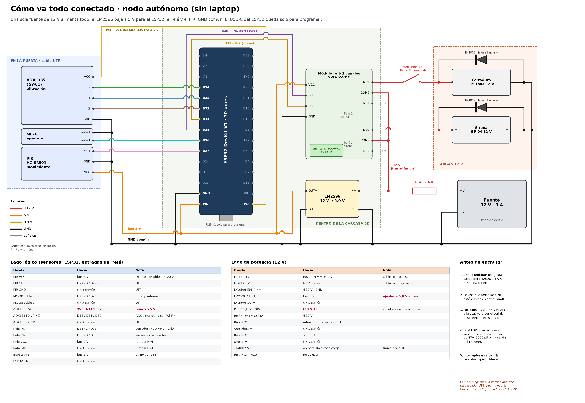

# Sistema IoT de seguridad residencial

Proyecto final de **CS5055 Internet of Things** (UTEC, 2026-2).

Un nodo **ESP32** vigila una puerta con tres sensores:

| Sensor | Qué detecta |
|---|---|
| PIR HC-SR501 | Movimiento |
| Contacto magnético MC-38 | Apertura de la puerta |
| Acelerómetro ADXL335 | Golpes y vibración |

Hay alarma solo si **dos sensores distintos se activan dentro de 10 s** (regla 2 de 3). Al dispararse, el nodo:

- enciende una **sirena** de 12 V;
- bloquea una **cerradura electromagnética** de 12 V, mediante un relé;
- publica todo por **MQTT**.

Un **tablero en Node-RED** muestra el estado del nodo, las métricas y la latencia, y desde él se puede armar, desarmar y probar los actuadores.

```
 Sensores ──▶ ESP32 (decide la alarma) ──▶ relé ──▶ sirena / cerradura
                  │  Wi-Fi + MQTT
                  ▼
        broker.hivemq.com:1883 (público)
                  │
                  ▼
        Node-RED + Dashboard 2 (en tu laptop) ──▶ http://localhost:1880/dashboard
```

---

## Contenido del repositorio

| Carpeta | Qué hay |
|---|---|
| `05_firmware/nodo_seguridad/` | **Firmware final** del ESP32. Es el que se carga para el proyecto. |
| `05_firmware/prueba_sensores/` | Sketch de prueba: lee los sensores y los publica, sin lógica de alarma. |
| `05_firmware/prueba_mqtt/` | Sketch de prueba: solo conexión Wi-Fi + MQTT. |
| `06_nodered/` | Carpeta de usuario de Node-RED: `flows.json`, `settings.js` y `package.json`. |
| `06_nodered/src/` | Fuente del tablero (`modelo.js` y `vista.vue`) y `build.py`, que genera `flows.json`. |
| `07_datos/` | Scripts de captura y análisis de datos, y scripts de las figuras del informe. |
| `04_compras_y_montaje/conexiones_sistema.png` | **Diagrama de conexiones pin por pin**, con la alimentación autónoma. |
| `04_compras_y_montaje/maqueta_puerta_final.png` | Maqueta de la puerta: medidas y ubicación de cada pieza. |

---

## 1. Lo que necesitas instalar

| Herramienta | Para qué | Dónde |
|---|---|---|
| **Git** | Clonar el repo | https://git-scm.com |
| **Arduino IDE 2** (o `arduino-cli`) | Compilar y cargar el firmware | https://www.arduino.cc/en/software |
| **Node.js 20 LTS o superior** | Correr Node-RED | https://nodejs.org |
| Driver USB del ESP32 *(solo Windows)* | Que aparezca el puerto COM | Driver **CP210x** de Silicon Labs |
| Python 3 + `mosquitto` *(opcional)* | Scripts de `07_datos/` y pruebas sin hardware | https://mosquitto.org/download |

Versiones con las que se probó todo:

- Núcleo **esp32 de Espressif 3.3.12**
- **PubSubClient 2.8**
- **Node-RED 4.1**
- **@flowfuse/node-red-dashboard 1.x**

```bash
git clone <URL-de-este-repo>
cd <carpeta-del-repo>
```

---

## 2. Firmware del ESP32

### 2.1 Configura tu Wi-Fi (obligatorio)

La contraseña del Wi-Fi **no está en el repo**. Crea tu propio `secrets.h` en la carpeta del sketch:

```bash
cd 05_firmware/nodo_seguridad
cp secrets.example.h secrets.h          # Windows: copy secrets.example.h secrets.h
```

Edita `secrets.h` con tu red:

```cpp
const char* WIFI_SSID = "NOMBRE_DE_TU_RED";
const char* WIFI_PASS = "CONTRASENA_DE_TU_RED";
```

> ⚠️ El ESP32 **solo se conecta a redes de 2,4 GHz**. Si usas el hotspot del celular, actívale la banda de 2,4 GHz o el modo de "máxima compatibilidad".
> Si vas a cargar los sketches de prueba, haz lo mismo en sus carpetas.

### 2.2 Opción A: Arduino IDE

1. Agrega las placas ESP32:
   - Abre **Archivo → Preferencias → URLs adicionales del Gestor de placas** y pega:
     `https://espressif.github.io/arduino-esp32/package_esp32_index.json`
   - Luego, en **Herramientas → Placa → Gestor de placas**, instala **esp32 de Espressif Systems** (3.3.x).
2. Instala la librería: **Herramientas → Gestionar librerías → PubSubClient** (de Nick O'Leary).
3. Abre `05_firmware/nodo_seguridad/nodo_seguridad.ino`.
4. Selecciona **Placa: "ESP32 Dev Module"** y el **puerto** del ESP32:
   - macOS: `/dev/cu.usbserial-XXXX`
   - Windows: `COMx`
5. Pulsa **Subir**. Si se queda en `Connecting.....`, mantén presionado el botón **BOOT** del ESP32 hasta que empiece a cargar.

### 2.2 Opción B: `arduino-cli`

```bash
arduino-cli config add board_manager.additional_urls https://espressif.github.io/arduino-esp32/package_esp32_index.json
arduino-cli core update-index
arduino-cli core install esp32:esp32@3.3.12
arduino-cli lib install "PubSubClient@2.8"

cd 05_firmware
arduino-cli board list                                   # mira el puerto
arduino-cli compile --fqbn esp32:esp32:esp32 nodo_seguridad
arduino-cli upload  --fqbn esp32:esp32:esp32 -p <PUERTO> nodo_seguridad
arduino-cli monitor -p <PUERTO> -c baudrate=115200       # ver el serial
```

### 2.3 Comprueba que arrancó

En el monitor serie, a **115200 baudios**, debes ver algo así:

```
=== Nodo de seguridad · nodo1 ===
[MQTT] conectando... OK
```

Si aparece `[WiFi] reintentando...`, revisa `secrets.h` y que la red sea de 2,4 GHz.

---

## 3. Tablero en Node-RED

Node-RED se instala **dentro de la carpeta del proyecto**, así que no hace falta instalarlo global.

```bash
cd 06_nodered
npm install                       # solo la primera vez (descarga Node-RED y Dashboard 2)
npx node-red -u . -s settings.js  # arranca Node-RED con este proyecto
```

Luego abre en el navegador:

- **Tablero:** http://localhost:1880/dashboard
- **Editor de flujos:** http://localhost:1880

Para detener Node-RED, pulsa `Ctrl + C` en la terminal.

> El tablero solo se abre desde la misma laptop, porque `settings.js` tiene `uiHost: "127.0.0.1"`. Para verlo desde el celular en la misma red Wi-Fi:
> 1. Cambia esa línea a `uiHost: "0.0.0.0"`.
> 2. Reinicia Node-RED.
> 3. Abre `http://<IP-de-tu-laptop>:1880/dashboard`.
>
> Ojo: el editor también queda abierto a esa red.

### Qué deberías ver

- **Estado del nodo:** en línea, con los sensores actualizándose unas 4 veces por segundo.
- **Contadores e historial de eventos:** PIR, puerta y vibración.
- **Latencia de extremo a extremo:** mediana de las últimas 40 lecturas. Para que salga bien, el ESP32 y la laptop deben tener la hora sincronizada por NTP.
- **Botones:** armar/desarmar, silenciar, probar sirena (pitido de 0,5 s) y cerradura.

### Probar el tablero sin el ESP32

Si no tienes el hardware a mano, puedes simular una lectura con `mosquitto_pub`:

```bash
mosquitto_pub -h broker.hivemq.com -t iot/seguridad/sensores -m '{"t":0,"estado":"armado","pir":1,"puerta_abierta":0,"x":1850,"y":1850,"z":2250,"vib":0,"d":5,"sirena":0,"cerradura":0,"pir_calibrando":false,"salida_s":0,"rssi":-60}'
```

Para ver todo lo que pasa en el broker:

```bash
mosquitto_sub -h broker.hivemq.com -v -t 'iot/seguridad/#' -t 'casa/nodo1/#'
```

### Si cambias el tablero

El tablero se edita en `06_nodered/src/modelo.js` (la lógica) y en `vista.vue` (la interfaz). Después regenera el flujo y reinicia Node-RED:

```bash
cd 06_nodered
python3 src/build.py flows.json
```

Si cambias algo directamente en el editor de Node-RED, se guarda en `flows.json` pero **no** en `src/`, y se pierde la próxima vez que alguien corra `build.py`.

---

## 4. Cómo funciona

### Tópicos MQTT

| Tópico | Dirección | Contenido |
|---|---|---|
| `iot/seguridad/sensores` | ESP32 → tablero | Lectura completa cada 250 ms, y al instante si algo cambia (JSON) |
| `casa/nodo1/evento` | ESP32 → tablero | Eventos de sensores, cambios de estado y confirmación de comandos |
| `casa/nodo1/cmd` | Tablero → ESP32 | `armar`, `desarmar`, `silenciar`, `sirena_on`, `sirena_off`, `cerradura_on`, `cerradura_off` |
| `casa/nodo1/lwt` | Broker | `online` / `offline`, retenido (última voluntad) |

### Estados del nodo

`desarmado` → **armar** → `saliendo` (30 s para salir) → `armado` → primer evento → `sospecha` → segundo sensor distinto en menos de 10 s → `alarma`.

- **En alarma:** se encienden la sirena (se apaga sola a los 60 s) y la cerradura. Para salir de la alarma hay que **desarmar** desde el tablero.
- **Vibración estando armado:** bloquea la cerradura de forma preventiva.
- **PIR al encender:** se ignora los primeros 60 s, mientras se estabiliza.

Los parámetros (umbral de vibración, ventana de 10 s, tiempos) están al inicio de `nodo_seguridad.ino`.

### ⚠️ El broker es público y compartido

- Cualquiera que conozca los tópicos puede **leerlos y enviar comandos**. Es solo para pruebas.
- **Si dos personas prueban a la vez con dos ESP32**, ambos publican como `nodo1` y los tableros se mezclan. Prueben **de a uno**, o cambien los tópicos en el firmware y en `06_nodered/src/build.py` (por ejemplo, `casa/nodo2/...`).

---

## 5. Hardware y conexiones



| Pin del ESP32 | Conexión |
|---|---|
| D27 | PIR OUT |
| D26 | MC-38, cable 1 (el otro cable va a GND; usa el pull-up interno) |
| D34 / D35 / D32 | ADXL335 X / Y / Z (VCC del ADXL335 a **3V3**, nunca a 5 V) |
| D25 | Relé IN1 → cerradura (activo en bajo) |
| D33 | Relé IN2 → sirena (activo en bajo) |
| VIN | 5 V del regulador LM2596 |

**Alimentación autónoma:** fuente de 12 V y 3 A → fusible de 4 A → COM del relé y entrada del **LM2596**. El LM2596 baja a **5,0 V** para el ESP32, el relé y el PIR. Todas las GND van unidas.

> **Antes de conectar el ESP32, ajusta el LM2596 a 5,0 V con el multímetro.** El **puente JD-VCC ↔ VCC del relé debe estar puesto**; sin él, el relé no conmuta.

Para programar o ver el serial por USB, desconecta antes el VIN. No alimentes por USB y por VIN a la vez.

---

## 6. Problemas frecuentes

| Problema | Solución |
|---|---|
| No aparece el puerto del ESP32 | Usa un cable USB **de datos** (no solo de carga). En Windows, instala el driver CP210x. |
| `Connecting.....` y luego falla | Mantén presionado **BOOT** al empezar la carga. |
| `[WiFi] reintentando...` sin fin | La red debe ser de 2,4 GHz; revisa `secrets.h`. |
| `fatal error: secrets.h: No such file` | No copiaste `secrets.example.h` como `secrets.h` en la carpeta del sketch. |
| El tablero dice "Sin datos del nodo" | El ESP32 no está publicando. Mira el serial, o prueba con `mosquitto_sub`. |
| El PIR se queda siempre en 1 | Gira al mínimo el potenciómetro de **tiempo** del módulo y baja un poco el de sensibilidad. Aléjalo del ESP32. |
| El LED del relé prende pero no hace clic | Falta el puente JD-VCC ↔ VCC, o el relé no recibe 5 V. |
| El ESP32 se reinicia cuando suena la sirena | Caída de voltaje: revisa que la salida del LM2596 esté en 5,0 V y aleja los cables de la sirena. |
| `npx node-red` falla | Necesitas Node.js 20 o superior (`node -v`). Corre `npm install` dentro de `06_nodered`. |

### Pendientes conocidos

- **El tablero no usa la "última voluntad".** Detecta la desconexión cuando pasan 5 s sin lecturas, y escucha el tópico `casa/nodo1/estado`, que el ESP32 no publica. El tópico correcto es `casa/nodo1/lwt`.
- **No hay retardo de entrada.** Para entrar con el sistema armado, primero hay que desarmar desde el tablero.

---

Equipo: Luis López, Jesús Velarde, Manuel Silva y Juan Inca.
